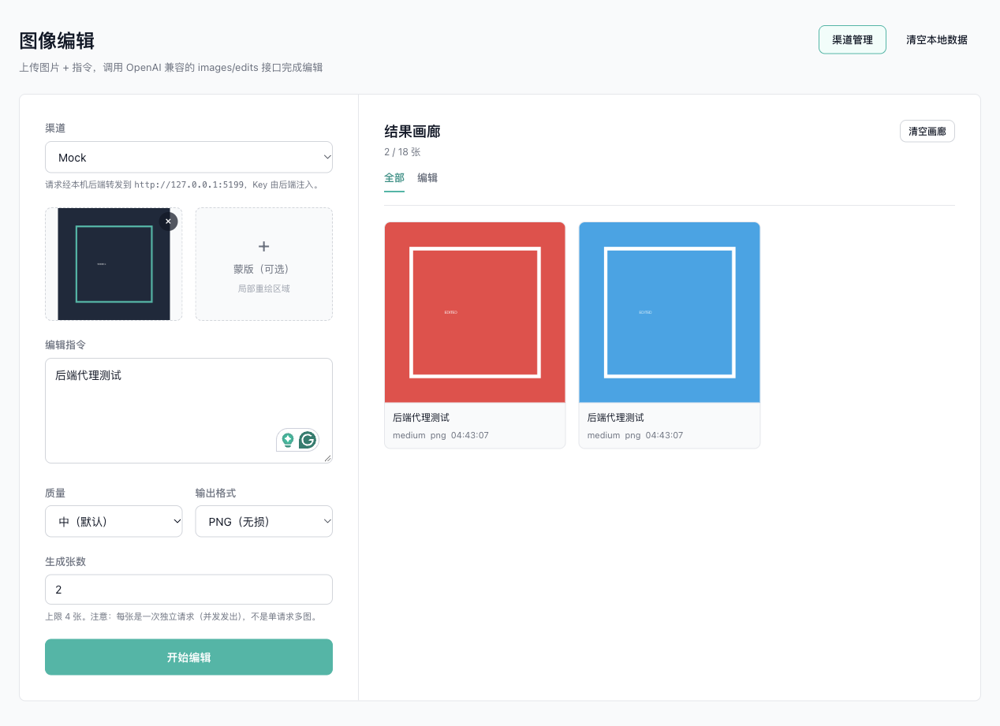
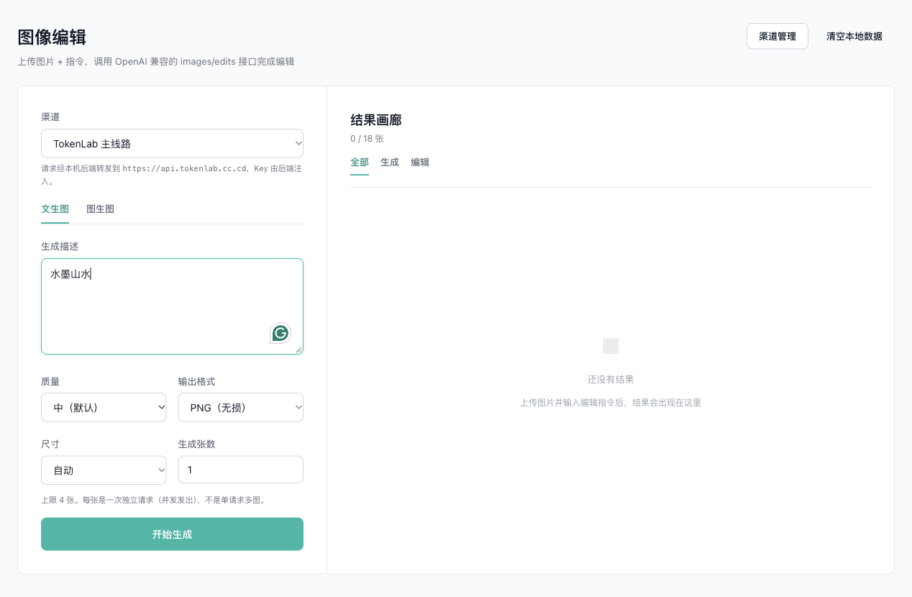
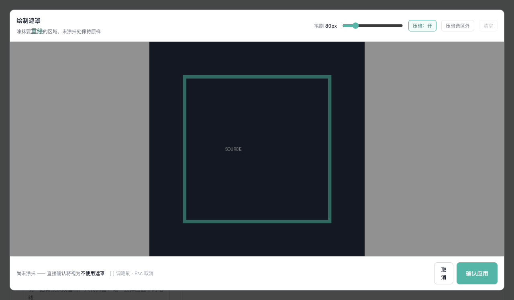
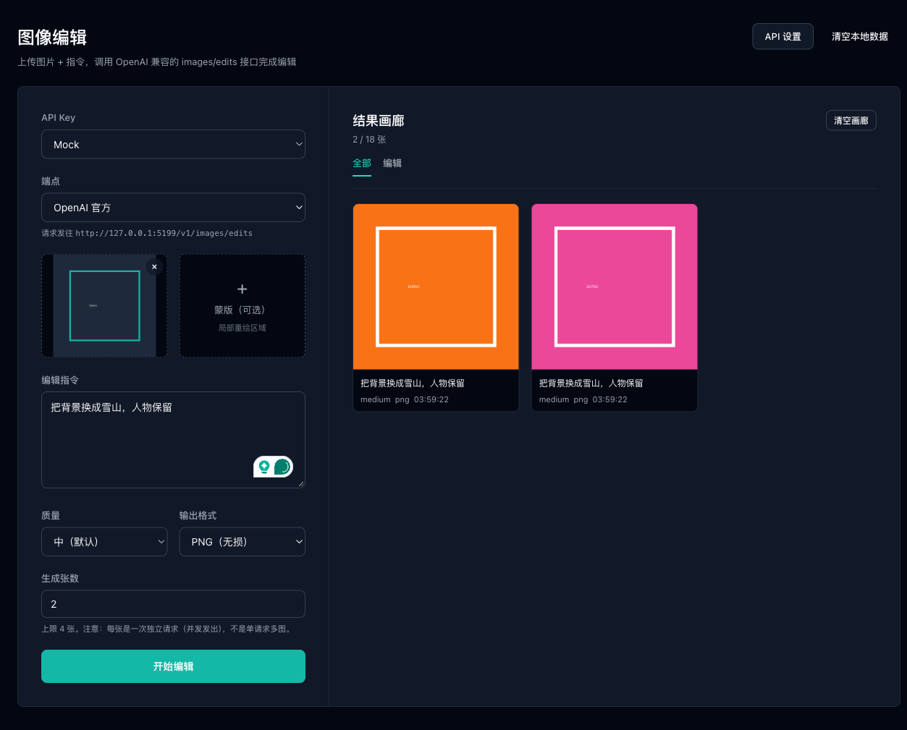

<p align="center">
  
</p>

<p align="center">
  
</p>

<h1 align="center">神笔 <sup>Shenbi</sup></h1>

<p align="center">
  <strong>本地优先的图像生成与精修工作台</strong><br/>
  对接任意 OpenAI 兼容 <code>images</code> 接口 · API Key 永不离开本机
</p>

<p align="center">
  <a href="#快速开始"></a>
  <a href="LICENSE"></a>
  
  
  
</p>

<p align="center">
  <a href="#特性">特性</a> ·
  <a href="#界面预览">界面</a> ·
  <a href="#架构">架构</a> ·
  <a href="#快速开始">安装</a> ·
  <a href="#仓库结构">结构</a> ·
  <a href="#安全与隐私">隐私</a>
</p>

---

## 为什么是神笔

大多数在线生图产品把 Key、历史和参数锁在云端。**神笔把工作台放回本机**：

- **Key 只存在后端磁盘**，浏览器与 Electron 渲染进程永远拿不到明文
- **多渠道并行**：TokenLab、woyao 等任意 OpenAI 兼容线路，一键切换、失败提示换线
- **文生图 + 图生图 + 局部重绘** 同一套表单，画廊可回填提示词与参数再迭代
- **可取消的批量生成**，进度可见，已完成结果保留
- 可选打包为 macOS 桌面应用「神笔」，数据目录可迁移

---

## 特性

| | |
|---|---|
| **双模式** | 文生图 `generations` / 图生图 `edits`，顶部一键切换 |
| **模型随渠道** | 读取渠道 `/v1/models`，下拉只列真正可用的模型 |
| **比例与分辨率** | 1:1 · 3:2 · 16:9 · 9:16 · 2:3，自动 / 1K / 2K / 4K |
| **多图参考** | 最多 16 张输入；提示词可用「第1张」「第2张」指代 |
| **遮罩精绘** | 全屏笔刷、实时直径预览、面积占比，确认后才生效 |
| **画廊** | 持久化、筛选、详情展开、一键回填、复制 / 下载 |
| **桌面端** | Electron 打包；设置里可改便携数据目录 |

---

## 界面预览

<p align="center">
  
  
</p>
<p align="center">
  
  
</p>

---

## 架构

```text
  ┌──────────────┐         ┌─────────────────────┐         ┌──────────────┐
  │  Vue 前端 /  │  渠道ID  │   本机 Node 代理     │  + Key  │  上游 images │
  │  神笔窗口    │ ──────► │   :5179              │ ──────► │  兼容接口    │
  │              │ ◄────── │  Key 只读写本地磁盘  │ ◄────── │              │
  └──────────────┘  无 Key  └─────────────────────┘         └──────────────┘
```

前端只持有渠道 ID；转发时由后端注入 Key。设计细节见 [`image-editor/README.md`](image-editor/README.md)。

---

## 快速开始

### 网页版（开发 / 自托管）

```bash
git clone https://github.com/zhaopeinan/ImageGenerator.git
cd ImageGenerator/image-editor
npm install
cp server/data/channels.example.json server/data/channels.json
# 编辑 channels.json，填入 endpoint 与 apiKey
npm start          # http://127.0.0.1:5179
```

### macOS 应用

```bash
cd image-editor
npm run electron:pack    # 产出 release/mac-arm64/神笔.app
# 或
npm run electron:dist    # 额外打出 .dmg
```

桌面版默认数据目录：`~/Library/Application Support/神笔/`。  
右上角 **设置** 可改为任意便携路径，整目录拷走即可换机。

### 热更新开发

```bash
npm run dev:api    # 终端 1：后端 :5179
npm run dev        # 终端 2：前端 :5178（需设 VITE_API_BASE）
```

---

## 仓库结构

```text
ImageGenerator/
├── image-editor/          # 神笔：Vue 3 + Pinia + Electron + Node 代理
├── photocraft-bridge/     # PhotoCraft ↔ 神笔 控制通道桥接
├── photocraft-plugin/     # PhotoCraft 插件模板与交接文档
├── rea-tokenlab/          # 渠道能力实测笔记（无密钥）
└── docs/assets/           # 仓库展示用主图与截图
```

---

## 安全与隐私

本仓库**刻意不包含**：

- API Key / `channels.json`
- PhotoCraft 控制令牌（`.exchange/`）
- `.env*`、个人笔记与本地绝对路径数据

本地密钥请放在 `image-editor/server/data/channels.json`（已在 `.gitignore`）。  
示例模板：`channels.example.json`。

---

## 路线图（摘录）

- [x] 文生图 / 图生图 / 遮罩精绘
- [x] 多渠道 Key 托管与模型探测
- [x] 生成可取消 + 画廊参数回填
- [x] macOS Electron 便携数据目录
- [ ] PhotoCraft Generative Fill 上游就绪后的深度桥接
- [ ] Windows / Linux 打包

欢迎 Issue / PR。重大改动前请先开讨论。

---

## License

[MIT](LICENSE) © peinan

<p align="center">
  <sub>主视觉由神笔对接的生图接口生成 · 笔锋化万象</sub>
</p>
